# Doce Encanto Confeitaria: site com pedidos online e painel de encomendas

Sistema completo para uma confeitaria receber **encomendas pelo site** e organizar tudo num
**painel administrativo**: cardápio com fotos, pedido online com total calculado no servidor,
envio do pedido pelo WhatsApp, página de acompanhamento para o cliente, agenda semanal de
produção, dashboard de faturamento e configurações da loja editáveis.

> Projeto de portfólio. A "Doce Encanto Confeitaria" (Uberaba-MG) é fictícia e o número de
> WhatsApp usado nos exemplos (`5534900000000`) é falso: troque em **Painel → Configurações**.


## Demonstração online

**Link:** _(em breve)_

Login do painel (`/admin`): **admin@confeitaria.dev** / **admin123** (aparece também na tela de
login).

É uma demonstração de verdade, rodando no plano grátis do Render: dá para fazer um pedido pelo
site e depois vê-lo no painel, mudar o status, cadastrar produtos com foto e editar as
configurações. Os dados **voltam ao original periodicamente** (a cada reinício e a cada 6 horas)
e a troca de senha do painel fica bloqueada. Se o site estiver "dormindo", o primeiro acesso pode
levar cerca de 1 minuto.

## Funcionalidades

### Site (cliente)

- Página inicial com destaque, "sobre nós", **cardápio com fotos e preços** (filtro por
  categoria), "como pedir", depoimentos, contato e localização.
- **Carrinho** que fica salvo no navegador.
- **Formulário de encomenda**: retirada ou entrega (com taxa), data e horário com as regras da
  loja (dias de funcionamento, horário, antecedência mínima), observações.
- O **total é sempre calculado no servidor** com os preços do banco. O navegador manda só
  produto e quantidade.
- Depois de enviar: botão **"Enviar pelo WhatsApp"** (link `wa.me` com a mensagem pronta) e
  **página de acompanhamento** com link secreto (`/pedido/<código>`), onde o cliente vê o status
  (Novo → Confirmado → Em produção → Pronto → Entregue).
- Layout responsivo (celular primeiro).

### Painel da loja (`/admin`)

- Login com JWT, troca de senha.
- **Dashboard**: pedidos de hoje, da semana, entregas do dia, pedidos em aberto, faturamento
  estimado da semana e do mês, contagem por status, próximas encomendas, mais vendidos.
- **Pedidos**: filtros por status, período e nome/telefone. Detalhe com mudança de status e botão
  para **avisar o cliente no WhatsApp** com a mensagem do status.
- **Agenda semanal**: encomendas de segunda a domingo por horário, com navegação entre semanas.
- **Produtos**: cadastro, edição, ativar/desativar, destaque e **upload de foto** (JPG, PNG ou
  WEBP, com limite de tamanho e verificação do conteúdo real do arquivo).
- **Depoimentos**: cadastrar, editar, ocultar ou excluir os depoimentos do site.
- **Configurações**: nome, WhatsApp, telefone, e-mail, Instagram, endereço, link do mapa, texto
  "sobre", dias e horário de funcionamento, retirada/entrega, taxa e área de entrega e
  antecedência mínima.

### Produção

- Um único deploy: a API serve o site já compilado.
- **SQLite** (padrão) ou **PostgreSQL**: basta trocar a `DATABASE_URL`.
- Fotos em **disco** ou em qualquer storage **compatível com S3** (Cloudflare R2, AWS S3...).
- Aviso de novo pedido para a dona pela **API oficial do WhatsApp (Cloud API)**: opcional,
  desligado por padrão.
- Segurança: `helmet` (CSP e cabeçalhos), CORS configurável, **limite de pedidos e de tentativas
  de login por IP**, validação de tudo com Zod, senha com bcrypt, `JWT_SECRET` obrigatório e
  forte em produção.
- `Dockerfile` pronto e guia de deploy no [DEPLOY.md](DEPLOY.md) (Railway, Render e domínio
  próprio).
- **Modo demonstração** (`DEMO_MODE=true`) e `render.yaml` para publicar um link de teste grátis
  no Render, sem banco externo.
- Documentação da API com Swagger em `/docs`.

## Tecnologias

| Parte     | Stack                                                                                   |
| --------- | --------------------------------------------------------------------------------------- |
| API       | Node.js 20, TypeScript, Express 5, Prisma (SQLite/PostgreSQL), Zod, JWT, Multer, Helmet |
| Site      | React 19, Vite, TypeScript, Tailwind CSS 4, React Router                                |
| Testes    | Vitest + Supertest (testes de integração da API)                                        |
| Qualidade | ESLint (typescript-eslint, react-hooks) e Prettier                                      |

## Como rodar

Pré-requisito: **Node.js 20.19 ou mais novo**.

```bash
npm install        # instala API e site (npm workspaces)
npm run setup      # cria api/.env, o banco SQLite e os dados de exemplo
npm run dev        # API em :3333 e site em :5173
```

- Site: <http://localhost:5173>
- Painel: <http://localhost:5173/admin>: **admin@confeitaria.dev** / **admin123**
- Documentação da API: <http://localhost:3333/docs>

### Modo produção local (como fica no servidor)

```bash
npm run build      # compila a API e o site
npm start          # tudo em http://localhost:3333
```

### Com Docker

```bash
docker build -t confeitaria .
docker run -p 3333:3333 -v confeitaria-data:/data \
  -e JWT_SECRET="um-segredo-aleatorio-com-mais-de-32-caracteres" \
  -e ADMIN_EMAIL="dona@minhaloja.com.br" -e ADMIN_PASSWORD="SenhaForte123" \
  -e PUBLIC_URL="http://localhost:3333" \
  confeitaria
```

O banco SQLite e as fotos ficam no volume `/data`.

Para rodar a **demonstração** (dados de exemplo recriados a cada start, sem volume):

```bash
docker run -p 3333:3333 -e DEMO_MODE=true confeitaria
```

## Scripts

| Comando                        | O que faz                                              |
| ------------------------------ | ------------------------------------------------------ |
| `npm run dev`                  | API e site em modo desenvolvimento (recarrega sozinho) |
| `npm run setup`                | Cria `.env`, aplica as migrations e popula o banco     |
| `npm run seed`                 | Apaga tudo e recria os dados de exemplo                |
| `npm run build`                | Compila API (`api/dist`) e site (`web/dist`)           |
| `npm start`                    | Sobe a versão compilada (API + site na mesma porta)    |
| `npm test`                     | Testes da API                                          |
| `npm run test:postgres -w api` | Os mesmos testes num PostgreSQL (`TEST_DATABASE_URL`)  |
| `npm run lint`                 | ESLint em todo o projeto                               |
| `npm run typecheck`            | Checagem de tipos (API, testes e site)                 |
| `npm run format`               | Formata o código com Prettier                          |

## Variáveis de ambiente

Todas estão comentadas em [`api/.env.example`](api/.env.example). As principais:

| Variável                         | Para que serve                                                      |
| -------------------------------- | ------------------------------------------------------------------- |
| `DATABASE_URL`                   | `file:./dev.db` (SQLite) ou `postgresql://...` (PostgreSQL)         |
| `JWT_SECRET`                     | Segredo do login. Em produção: aleatório, 32+ caracteres            |
| `PUBLIC_URL`                     | Endereço do site, usado no link de acompanhamento do pedido         |
| `ADMIN_EMAIL` / `ADMIN_PASSWORD` | Cria o primeiro admin quando o banco está vazio (produção)          |
| `STORAGE_DRIVER`                 | `local` (disco, pasta `UPLOAD_DIR`) ou `s3` (R2, S3...)             |
| `MAX_UPLOAD_MB`                  | Tamanho máximo da foto (padrão 3 MB)                                |
| `RATE_LIMIT_ORDERS`              | Pedidos por IP a cada 15 minutos (padrão 10)                        |
| `TRUST_PROXY`                    | `1` atrás de proxy (Render, Railway) para o limite por IP funcionar |
| `CORS_ORIGIN`                    | Outros domínios que podem chamar a API (vazio = só o próprio site)  |
| `NOTIFY_PROVIDER`                | `none`, `log` ou `whatsapp_cloud` (aviso automático para a dona)    |
| `DEMO_MODE`                      | `true` só no link de demonstração: recria os dados a cada start     |
| `DEMO_RESET_HOURS`               | Na demonstração, de quantas em quantas horas os dados voltam (6)    |

## Testes

```bash
npm test
```

São **57 testes de integração** (Vitest + Supertest) que sobem a API de verdade num banco de
teste, e passam tanto no SQLite quanto no PostgreSQL. Eles cobrem:

- login, token inválido, troca de senha e limite de tentativas;
- CRUD de produtos, upload de foto (tipo, tamanho e arquivo falso com extensão de imagem);
- pedido: validações, total calculado pelo servidor (ignora preço enviado pelo cliente), taxa de
  entrega, dias e horário de funcionamento, antecedência mínima, produto inativo, página de
  acompanhamento sem dados sensíveis, limite de pedidos por IP;
- filtros do painel, mudança de status (pedido entregue/cancelado não muda mais);
- dashboard (contagens e faturamento), depoimentos, configurações, cabeçalhos de segurança e CORS;
- mensagem do WhatsApp e integração com a Cloud API (com `fetch` simulado);
- modo demonstração: troca de senha bloqueada, dados de exemplo recriados, fotos de exemplo
  servidas do código e validação das variáveis de ambiente (produção continua exigindo
  `JWT_SECRET` forte).

## Telas

| Cardápio                                      | Encomenda                                                |
| --------------------------------------------- | -------------------------------------------------------- |
| 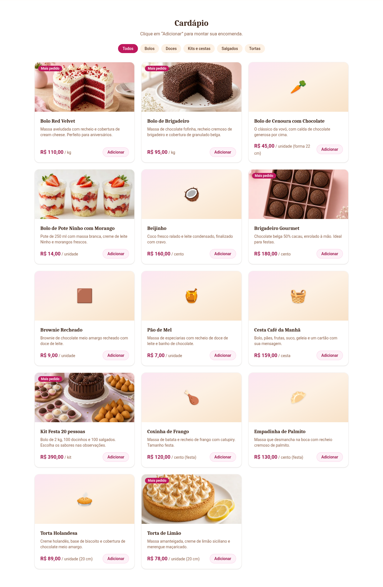 | 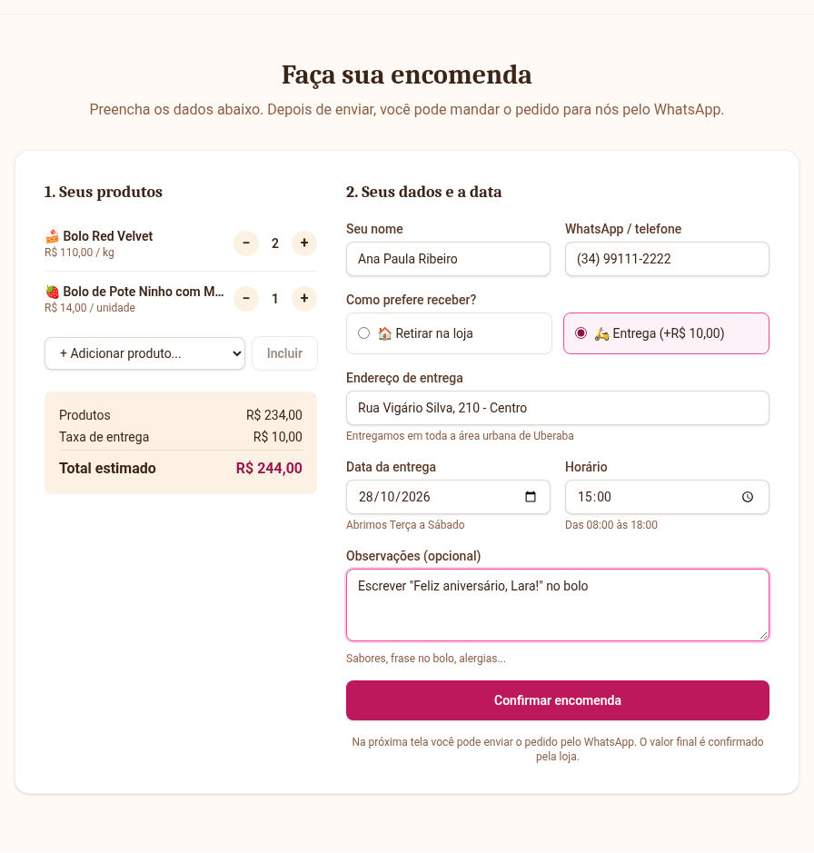 |

| Pedido confirmado                                        | Acompanhamento (celular)                                         |
| -------------------------------------------------------- | ---------------------------------------------------------------- |
| 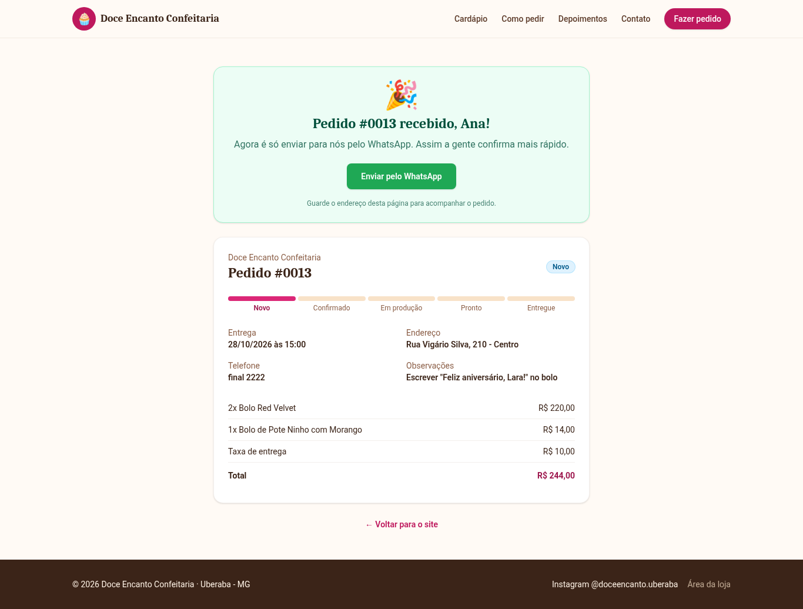 |  |

| Dashboard                                       | Pedidos                                     |
| ----------------------------------------------- | ------------------------------------------- |
| 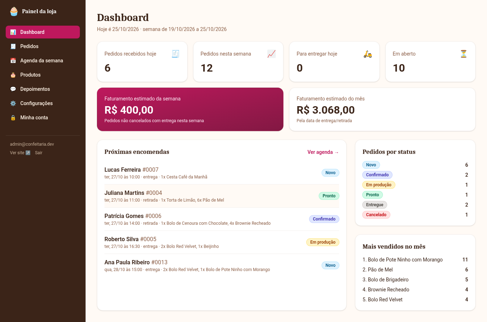 | 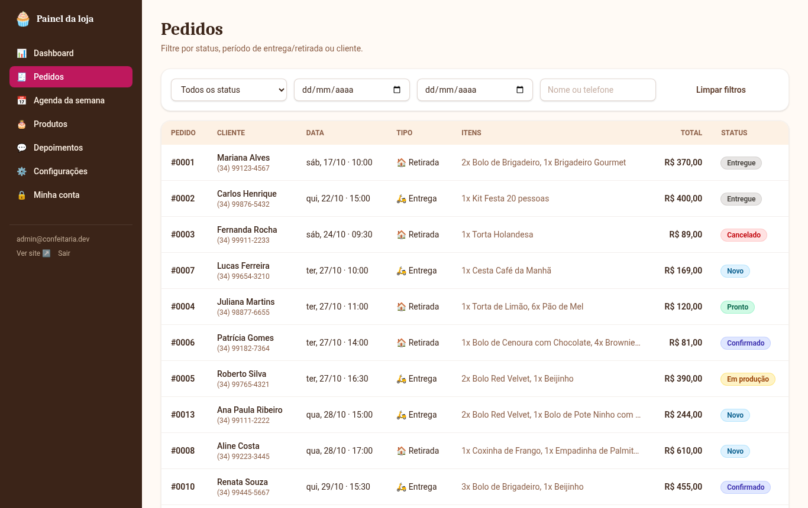 |

| Detalhe do pedido                                  | Agenda semanal                                    |
| -------------------------------------------------- | ------------------------------------------------- |
| 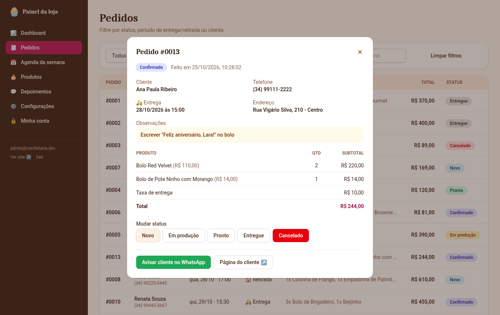 | 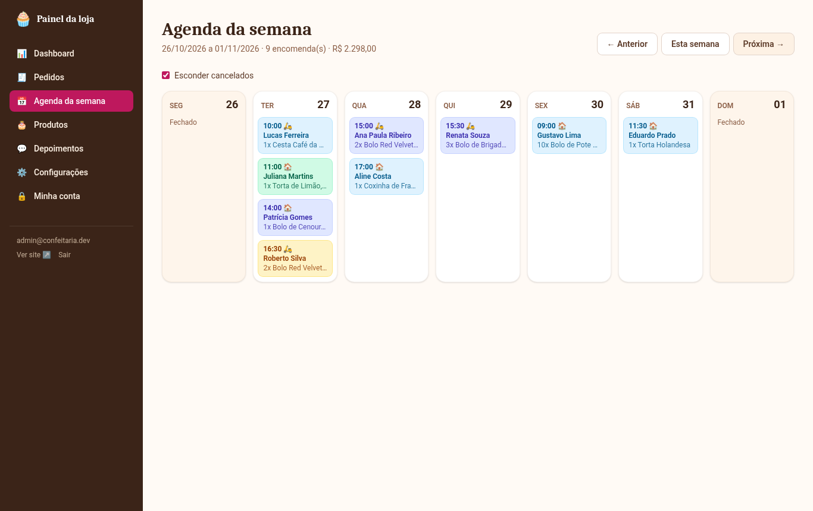 |

| Produtos                                      | Foto do produto                                        |
| --------------------------------------------- | ------------------------------------------------------ |
| 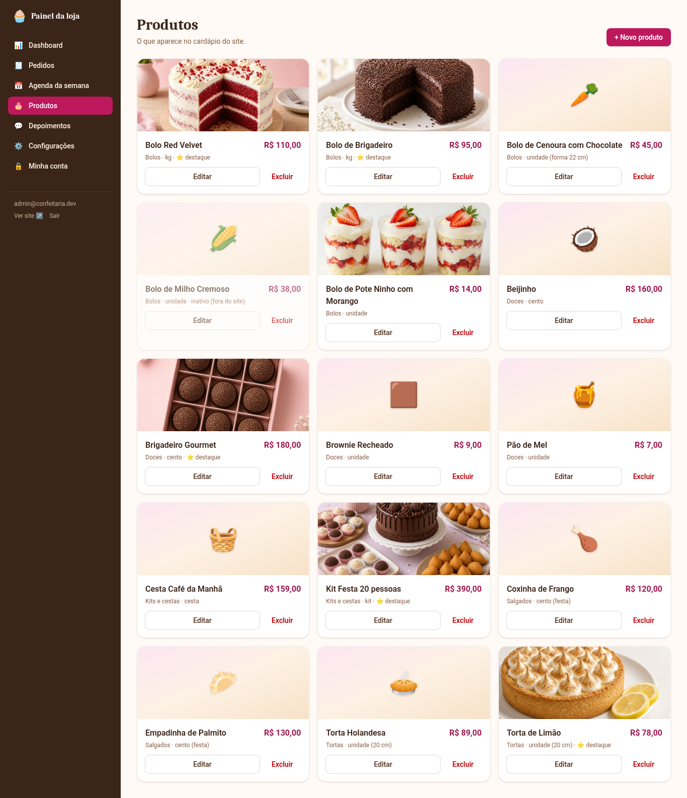 | 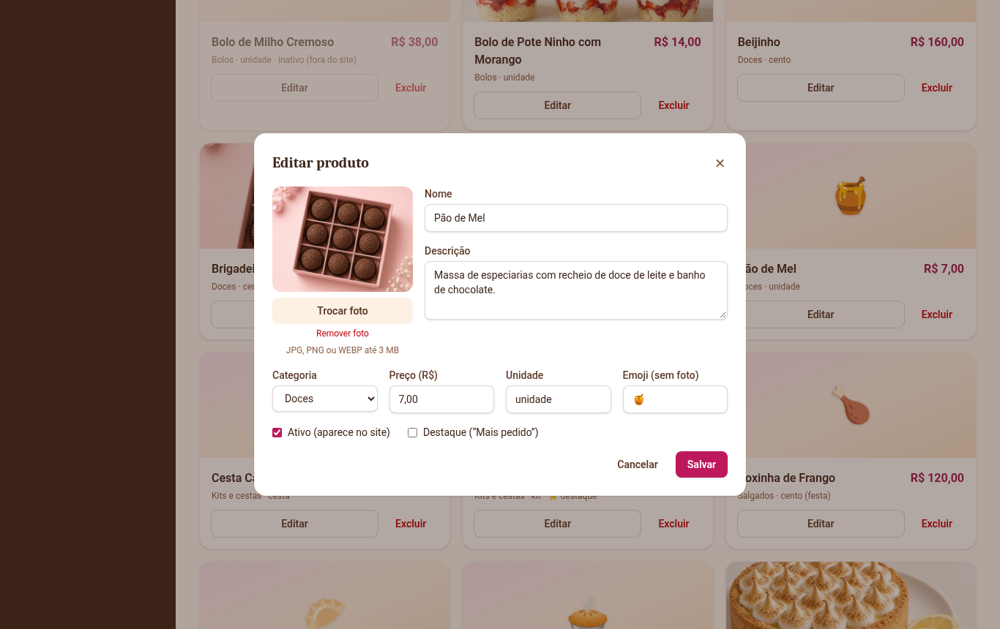 |

| Depoimentos                                         | Configurações                                           |
| --------------------------------------------------- | ------------------------------------------------------- |
| 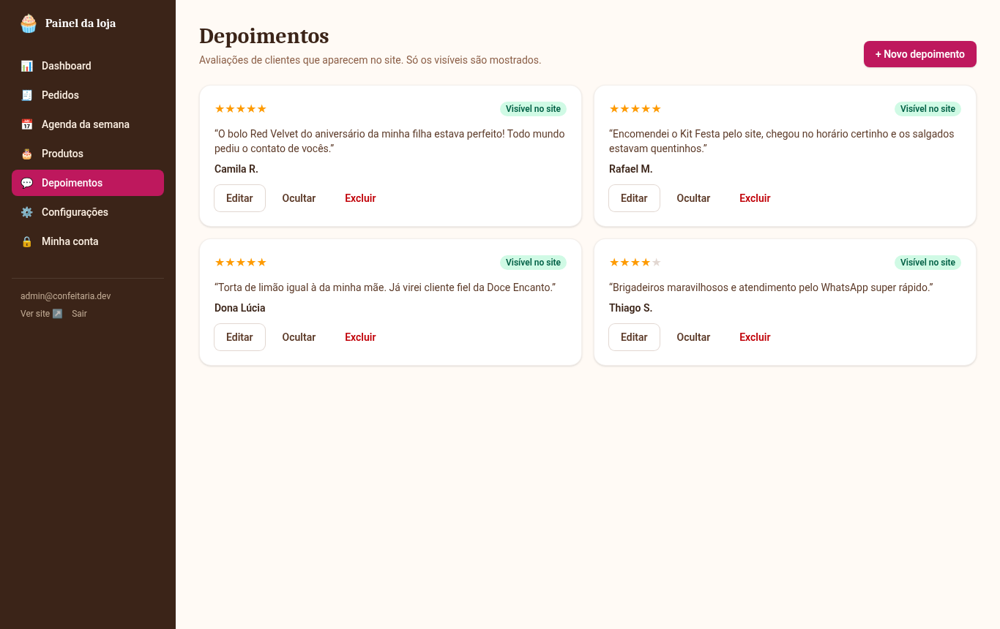 | 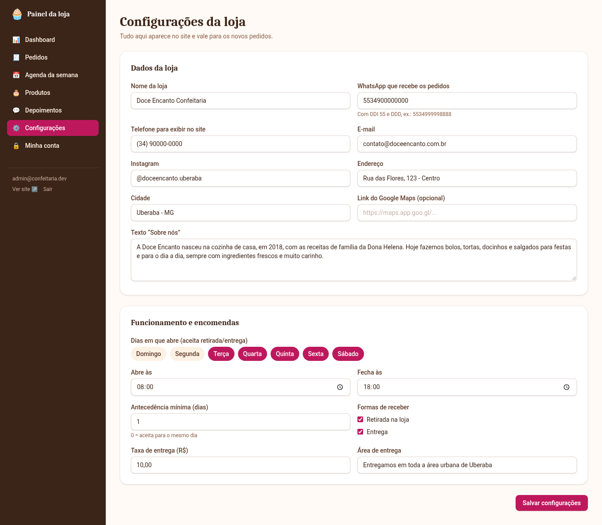 |

| Login                                   | Celular                                         |
| --------------------------------------- | ----------------------------------------------- |
| 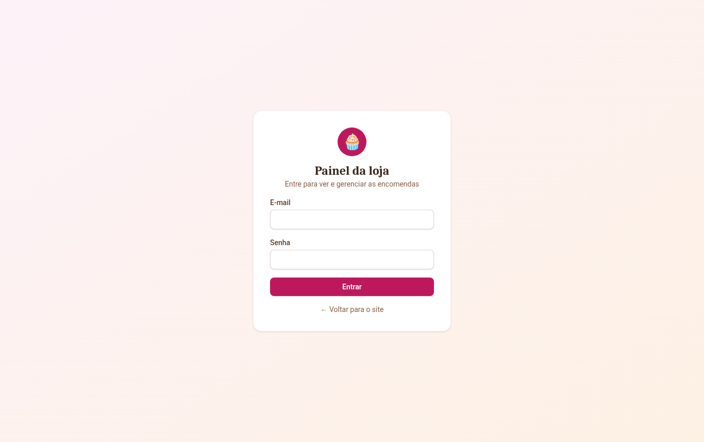 |  |

## Estrutura

```
confeitaria-pedidos/
├── api/                    # Express + Prisma
│   ├── prisma/             # schema SQLite, migrations, seed e fotos de exemplo
│   │   └── postgres/       # schema e migrations para PostgreSQL
│   ├── scripts/prisma.mjs  # escolhe o schema certo pelo DATABASE_URL
│   ├── src/
│   │   ├── config/env.ts   # validação das variáveis de ambiente
│   │   ├── lib/            # datas, dinheiro, storage de fotos, notificação
│   │   ├── middlewares/    # auth, erros, limite por IP
│   │   └── modules/        # auth, products, orders, dashboard, settings, testimonials
│   └── tests/
├── web/                    # React + Vite + Tailwind
│   └── src/
│       ├── lib/            # chamadas à API, formatação, login
│       ├── components/     # botões, campos, modal...
│       └── pages/site|admin
├── Dockerfile
├── DEPLOY.md
└── GUIA-DO-JOAO.md
```

## Autor

João Batista: [joaobatistatrevours@gmail.com](mailto:joaobatistatrevours@gmail.com)

Licença MIT.
